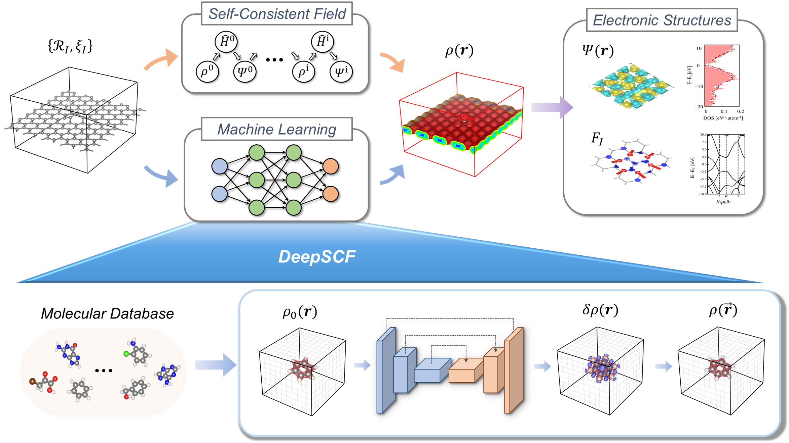

DeepSCF
======
<p align="center">
  
</p>

The DeepSCF is a machine-learning strategy to accelerate the density functional theory (DFT) calculations by learning the map between the self-consistent field (SCF) electron density $\rho$ and the initial guess density $\rho_0$. This repository contains the official implementation as described in the paper: [*Convolutional network learning of self-consistent electron density via grid-projected atomic fingerprints*](https://doi.org/10.1038/s41524-024-01433-0). The implementation employs three-dimensional (3D) convolutional neural networks (CNNs) based on the [U-Net](https://arxiv.org/abs/1505.04597) architecture, using the PyTorch framework.  

## Preliminary

### Installation
Run the following command in the path of DeepSCF:
```bash
git clone https://github.com/yhkimlab/DeepSCF.git
cd DeepSCF
```

### Requirements

To reproduce the original DeepSCF environment, we recommend creating an
isolated Anaconda environment with Python `3.7.15` and the following package
versions:

- torch==1.12.1
- h5py==2.10.0
- hydra-core==1.3.2
- numpy==1.21.5
- omegaconf==2.3.0

`omegaconf==2.3.0` is required because `hydra-core==1.3.2` declares
`omegaconf>=2.2,<2.4` and is incompatible with `omegaconf==2.0.6`.
Python `3.7.15` is recommended because binary wheels for these package
versions are not available for every newer Python release.

Create and activate the environment, then install the requirements:

```bash
conda create -n deepscf python=3.7.15
conda activate deepscf
pip install -r requirements.txt
```

If you plan to use a GPU with PyTorch, ensure that you install the appropriate PyTorch version compatible with your system and CUDA version. Refer to the [PyTorch installation guide](https://pytorch.org/get-started/previous-versions/) for detailed instructions .

### Pretrained models

Download and install the pretrained models from the
[`DeepSCF_v1`](https://github.com/yhkimlab/DeepSCF/releases/tag/DeepSCF_v1)
release. The setup script installs the weights and train/test split indexes
under `pretrained/<model_case>/{model.pt,data.pkl}`, as used by the prediction
and evaluation configurations.

```bash
bash setup.sh
```

### Bundled SIESTA Source

The modified SIESTA source required to generate the grid-projected features and
run a non-SCF calculation from a predicted `RHO` is included under
[`src/siesta-4.1-b4/`](src/siesta-4.1-b4/). For a serial Linux build with
GNU Fortran 10 or newer, install GNU Fortran, a C compiler, Make, and the
development libraries for BLAS and LAPACK, then run from the project root:

```bash
(
  cd src/siesta-4.1-b4/Obj
  sh ../Src/obj_setup.sh
  cp gfortran-system.make arch.make
  make -j2
)
```

The resulting executable is `src/siesta-4.1-b4/Obj/siesta`. Use this path
explicitly in the example below: another SIESTA installation may not write
`rhoatom` and `rhoover`. For other compilers or MPI builds, adapt the templates
and follow the [build instructions](src/siesta-4.1-b4/Obj/README).

## Prepare the dataset

### Dataset format

To train DeepSCF, prepare one HDF5 file per structure. Each file contains
`target` with shape `[x, y, z]` and `feature` with shape `[3, x, y, z]`.
The preprocessing scripts write these datasets in the format expected by the
training, prediction, and evaluation code.

The datasets and evaluation inputs used by the paper configurations are
organized under [`datasets/`](datasets/README.md). Training inputs are stored in
`datasets/train/`, while rotation, scaling, and example inputs are stored in
`datasets/evaluation/`.

The model names correspond to the following directory names in `configs/`,
`datasets/`, and the result paths:

| Model | Directory name |
|---|---|
| Original | `original` |
| R | `r` |
| R+S | `r_plus_s` |
| (R+S)×2 | `r_plus_s_x2` |
| (R+S)×3 | `r_plus_s_x3` |

The setup script installs the corresponding final weights and train/test split
indexes under `pretrained/<model_case>/{model.pt,data.pkl}`.

The unscaled target density $\rho$ comes from `Molecular.RHO`. The input
`feature` channels are ordered as follows:

| Channel | SIESTA output | Scaling statistics |
|---|---|---|
| `feature[0]` | `Molecular.IOCH` | `mean2`, `std2` |
| `feature[1]` | `rhoatom` ($\rho_0$) | `mean3`, `std3` |
| `feature[2]` | `rhoover` | `mean4`, `std4` |

All three input channels are standardized. Set `model.mean` and `model.std`
to `mean3` and `std3` so the model reconstructs the initial density from
`feature[1]`. For pretrained models, use their provided scale files instead
of calculating new statistics from the prediction inputs.


### Generate SIESTA grids

Use the bundled SIESTA source to generate the target density and input features.
For an SCF calculation, fix the grid dimensions and enable the charge-density
outputs as follows:


```
SaveRho          .true.
SaveIonicCharge  .true.
```

`SaveRho` writes `Molecular.RHO`, and `SaveIonicCharge` writes
`Molecular.IOCH` when `SystemLabel` is `Molecular`. The modified source also
writes `rhoatom` and `rhoover`, which are used by the preprocessing pipeline.
Note that you can also adjust `MeshSizes` for the desired simulation grid:

```text
%block MeshSizes
  80 80 80
%endblock MeshSizes
```

 A complete SCF input is
available in
[`dft_calc/1.preprocess/input/RUN.fdf`](dft_calc/1.preprocess/input/RUN.fdf).
All SIESTA grid objects are stored in Fortran unformatted format and can be
read with `utils/siestaio.py`.

**Note**
Specially, the $\rho_0$ can be indirectly obtained by substracting the $\delta\rho$ (stored in `.DRHO` file), which can be generated by SIESTA calculation with the `SaveDeltaRho` option set to `true`, from the $\rho$ using the relation $\rho_0=\rho-\delta\rho$.  

### Preprocess the grids

The preprocessing pipeline converts completed SIESTA calculations,
calculates the feature scaling statistics, and assembles the HDF5 dataset:

```bash
python dft_calc/1.preprocess/1.convert.py CALCULATIONS RAW_DATA
python dft_calc/1.preprocess/2.scale.py RAW_DATA scale.txt
python dft_calc/1.preprocess/3.collect.py RAW_DATA scale.txt OUTPUT_DATASET
```

See the [preprocessing guide](dft_calc/1.preprocess/README.md) for the required
SIESTA output files, directory layout, scaling procedure, and pretrained-model
workflow. Its [complete example](dft_calc/1.preprocess/README.md#complete-example-scf-to-non-scf)
uses concrete paths and continues through prediction and non-SCF.

In the original paper, datasets were generated from the [TABS database](https://www.sciencedirect.com/science/article/pii/S2210271X14002400). The input and target feature used for the Org model can be found at https://doi.org/10.5281/zenodo.10075554.


## Train DeepSCF  

Training **DeepSCF** is easily managed using `hydra`. The default values are set in `configs/train/default.yaml`, and the paper experiment configurations are organized under `configs/train/`. Below is an overview of the key configuration features:

**Hydra**  
- **`run.dir`**: Defines the directory where training results will be saved. The folder can be structured by date and time (e.g., `./results/train/2024-11-26/14-30-45`), or you can specify a custom path name.  

**Dataset**  
- **`path`**: Specifies the path to the dataset containing the `HDF5` files for materials.
- **`augmentation`**: Indicates the augmentation configuration.
- **`batch_size`**: Number of samples per batch. Default is `1`.  
- **`ratio`**: Split ratio for training and validation datasets. A value of `0.8` means 80% of the data is used for training, and 20% for validation/testing.  

**Model**  
- **`mean`**: Mean value for $\rho_0$ in the input features.  
- **`std`**: Standard deviation for $\rho_0$ in the input features


Run the default training configuration with:

```bash
python train.py
```

To run one of the configurations used for the paper, select its path relative to `configs/train` without the `.yaml` extension. For example:

```bash
python train.py --config-name=hyperparameter/features/input_1
```

Individual configuration values can also be overridden directly from the
command line using Hydra's `key=value` syntax. For example:

```bash
python train.py model.layers=64 optimizer.lr=1e-4 train.epochs=200
```

## Predict with DeepSCF

Once training has completed, a `model.pt` file is generated. The final models
used in the paper are also available under `pretrained/`. Prediction
configurations are organized under `configs/predict/`. Below are the key
configuration features:

**Load**  
- **`model`**: Project-relative path to the pretrained model used for prediction (e.g. `pretrained/original/model.pt`).

**Model**  
- All configuration settings should be same with those used for using the pre-trained model

**target** 
- **`path`**: Path to the target data file for prediction. This can either (1) the `data.pkl` file in the trained directory for the evalutation set used during the training, (2) the path of `HDF5` file for input feature of specific material, or (3) the path where serveral `HDF5` files are loacted.
- **`cell`**: Defines the lattice vectors of the simulation cell in `Bohr` unit. This does not necessarily describe the full case but rather serves as a reference for a specific material.
- **`mesh`**: Specifies the number of grid points along the x-, y-, and z-directions corresponding to the simulation box defined by `cell`.

Run the default configuration or select a paper experiment configuration as follows:
```bash
python predict.py
python predict.py --config-name=examples/r_plus_s_x3
```

Then, the predicted $\rho$ for each material will be stored in in SIESTA `grid object` based on the `sietaio.py` module.


## Evaluate DeepSCF

`evaluate.py` measures the percentage error of a trained model against the
target electron densities stored in the HDF5 files. Its configuration is read
from `configs/evaluate/` and uses the same model settings and target path format
as prediction. The target can be a single HDF5 file, a directory containing
HDF5 files, or a `data.pkl` file containing the train/test split.

Run the default evaluation configuration or select a paper experiment configuration as
follows:

```bash
python evaluate.py
python evaluate.py --config-name=examples/r_plus_s_x3
```

The per-material errors are written to `log.txt`, and the aggregate percentage
error is written to `summary.txt` in the configured Hydra output directory.


## Predict Electronic Structures with DeepSCF  

After obtaining the predicted electron density $\rho$ in the SIESTA `grid object` format, the corresponding electronic structure can be evaluated by performing a single-shot non-SCF calculation.  

Use the bundled SIESTA source. Place the predicted grid in the calculation
directory as `In.RHO` and use these options:

```text
MaxSCFIterations  1
SCF.MustConverge  .false.
SCF.Mix.First     .false.
SCF.Read.Charge   .true.
```

`SCF.Read.Charge` makes the bundled source read `In.RHO`, while the one-step
settings prevent a normal SCF convergence cycle. The cell and `MeshSizes` must
match the predicted grid. A complete non-SCF input template is available at
[`dft_calc/2.evaluation/input/RUN.fdf`](dft_calc/2.evaluation/input/RUN.fdf).

## Reproduce one example through non-SCF

Run the included `0001` molecule through a complete, checked workflow with the
pretrained **Original** model:

```text
Structure + pseudopotentials
    └─ reference SCF ─┬─ Molecular.RHO ────────────── reference for evaluation
                     └─ IOCH + rhoatom + rhoover
                          └─ fixed model scaling → DeepSCF → predicted RHO
                                                               └─ one-step non-SCF
```

The [step-by-step guide](dft_calc/1.preprocess/README.md#complete-example-scf-to-non-scf)
explains the role of each file, gives runnable commands and success checks,
and shows an actual density comparison. It covers:

1. Building the bundled modified SIESTA and running a converged reference.
2. Converting four grids into HDF5 and applying the Original model's fixed scale.
3. Predicting a density and measuring its error against the reference.
4. Reading that prediction as `In.RHO` for one non-SCF iteration.
5. Comparing total energy, eigenvalues and forces with the SCF reference.

No training or downloaded HDF5 dataset is needed for this example. The
reference SCF regenerates the features and supplies the comparison target;
that target is not an input to the neural network. Because the walkthrough
includes reference SCF, its total runtime is not a DeepSCF speedup benchmark.

In a CPU run of this example, SCF converged
in 11 iterations and non-SCF completed in one. The predicted density error
was **1.8169%**, compared with **14.3897%** for the atomic baseline. The
absolute total-energy error was **0.004795 eV/atom (4.795 meV/atom)**,
meeting the **0.04 eV/atom** chemical-accuracy criterion adopted for this
walkthrough. For 16 atoms this corresponds to +0.07672 eV in total.
Energy accuracy, self-consistency and force accuracy are assessed separately.

## How to cite
If you want to use DeepSCF, please cite:

```
@article{deepscf,
   author = {Lee, Ryong-Gyu and Kim, Yong-Hoon},
   title = {Convolutional network learning of self-consistent electron density via grid-projected atomic fingerprints},
   journal = {npj Computational Materials},
   volume = {10},
   number = {1},
   pages = {248},
   ISSN = {2057-3960},
   DOI = {10.1038/s41524-024-01433-0},
   url = {https://doi.org/10.1038/s41524-024-01433-0},
   year = {2024},
   type = {Journal Article}
}
```
