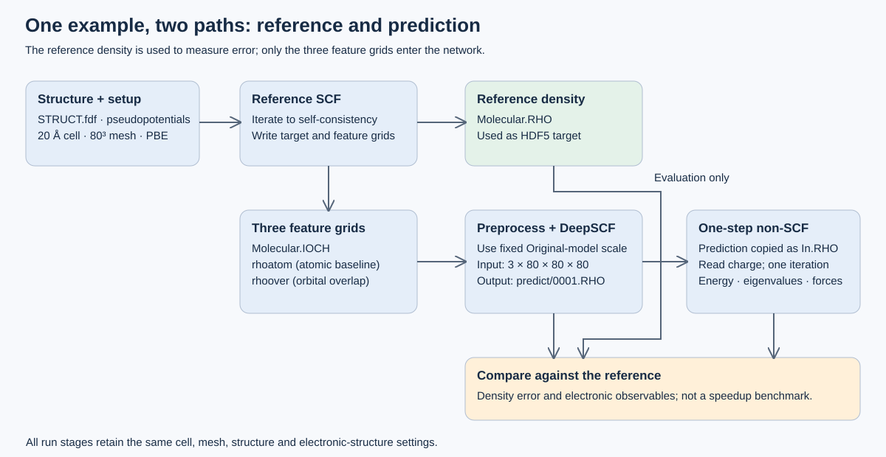
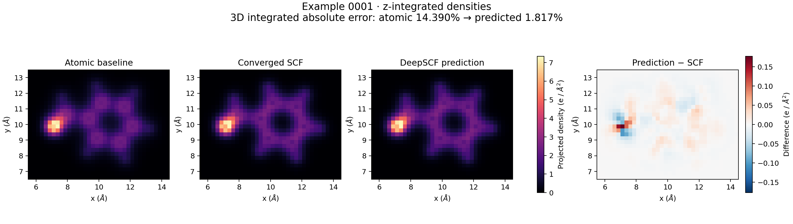

<a id="complete-example-scf-to-non-scf"></a>

# Reproduce one example through non-SCF

This walkthrough takes the included `0001` molecule from a reference SIESTA
calculation to a DeepSCF density prediction and a one-step electronic-structure
calculation. It uses the pretrained **Original** model; no training or downloaded
HDF5 dataset is required.

The purpose is to verify the complete data path and compare the prediction with
a converged reference. The initial reference SCF calculation is deliberately
included to regenerate all four grids and measure density error. Consequently,
the total runtime of this tutorial is **not** a measure of DeepSCF acceleration.

## 1. Understand the calculation before running it



Ordinary SCF repeatedly constructs a Hamiltonian from a density, solves for
electronic states, and updates the density until convergence. Here, DeepSCF
predicts a density from three grid features. SIESTA then uses that prediction
to construct the potential and perform one SCF-loop iteration, without
iterating to self-consistency. This is the “single-shot non-SCF” calculation
used in this guide.

The example is a neutral, non-spin-polarized 16-atom molecule (C7H8O), in a
20 Å cubic cell with an `80 × 80 × 80` grid and Gamma-point sampling. Both
calculations use the same structure, pseudopotentials, DZP basis, and PBE
exchange-correlation settings.

### Which density goes where?

| File from reference SIESTA | Role | Location in assembled HDF5 |
| --- | --- | --- |
| `Molecular.RHO` | Converged reference density, used to measure prediction error | `target` |
| `Molecular.IOCH` | Ionic-charge grid feature | `feature[0]` |
| `rhoatom` | Atomic reference density, also the model's residual baseline | `feature[1]` |
| `rhoover` | Orbital-overlap grid feature from the modified SIESTA | `feature[2]` |

The neural network receives `feature`; it does **not** receive `target` as an
input. The current conversion and prediction scripts nevertheless require
`target` in the HDF5 file for their evaluation/logging workflow.

The model reconstructs the unscaled atomic baseline from `feature[1]`, adds
its learned correction, applies a nonnegative activation, and normalizes the
predicted grid to the integrated charge of the baseline. Thus, charge
normalization and spatial accuracy are separate checks: the correct electron
count alone does not demonstrate a good density prediction.

## 2. Prepare the environment and a fresh output directory

Use the Python environment and pretrained-model installation described in the
project README. The documented environment uses Python 3.7.15, PyTorch 1.12.1,
h5py 2.10.0, NumPy 1.21.5, Hydra 1.3.2, and OmegaConf 2.3.0.

Build the bundled modified SIESTA, rather than selecting an unrelated `siesta`
from `PATH`. A serial build needs GNU Fortran 10 or newer, a C compiler, Make,
and development libraries for BLAS and LAPACK:

```bash
(
  set -e
  cd src/siesta-4.1-b4/Obj
  sh ../Src/obj_setup.sh
  cp gfortran-system.make arch.make
  make -j2
)
```

Start in the project root and keep the following variables in the same Bash
session throughout the guide:

```bash
PROJECT_ROOT="$PWD"
SIESTA_BIN="$PROJECT_ROOT/src/siesta-4.1-b4/Obj/siesta"
WORKDIR=results/reproduce/0001

test -x "$SIESTA_BIN"
test -s pretrained/original/model.pt
test -s dft_calc/1.preprocess/metadata/original/scale.txt
mkdir -p "$(dirname "$WORKDIR")"
mkdir "$WORKDIR"
mkdir "$WORKDIR/scf"
```

Use a fresh `WORKDIR` for every attempt. The plain `mkdir "$WORKDIR"`
intentionally rejects an existing run directory. Old density-matrix or output
files can otherwise make the calculation harder to interpret.

Keep `WORKDIR` **relative to the project root** for the commands below. The
current prediction/evaluation scripts prepend the project root to
`target.path` and `load.model`; passing an absolute dataset path does not work
as expected. `hydra.run.dir`, by contrast, is an absolute output path here.

## 3. Generate the reference and feature grids

```bash
cp -R dft_calc/1.preprocess/examples/0001 "$WORKDIR/scf/"
(
  set -e
  cd "$PROJECT_ROOT/$WORKDIR/scf/0001"
  "$SIESTA_BIN" < RUN.fdf > stdout.txt 2> stderr.txt
  for grid in Molecular.RHO Molecular.IOCH rhoatom rhoover; do
    test -s "$grid"
  done
)
```

The included input enables `SaveRho` and `SaveIonicCharge` and fixes the grid
with `MeshSizes`. The bundled source additionally writes `rhoatom` and
`rhoover`. These extra outputs are why a stock SIESTA executable is not a
substitute for this tutorial.

Both stages may warn that the explicit mesh gives a smaller cutoff than
requested. For this 20 Å cell, the fixed `80³` mesh corresponds to an effective
cutoff of **44.220 Ry** in the tested build. The reference requests 80 Ry;
the non-SCF template omits `MeshCutoff`, so it reports the 300 Ry default.
Both nevertheless use the same explicit `80³` mesh. Preserve that mesh for
this pretrained example; increasing the requested cutoff alone does not
change an explicitly fixed mesh. This tutorial does not establish basis or
grid convergence.

Inspect the log before continuing:

```bash
grep -E 'SCF Convergence|SCF cycle converged|Job completed|^[[:space:]]*scf:' \
  "$WORKDIR/scf/0001/stdout.txt"
```

Require both a convergence message and `Job completed`, as well as the four
nonempty grid files. Successful process termination or file existence alone
does not establish SCF convergence. For this example, a CPU run reported `SCF cycle converged after 11 iterations`
and `Job completed`. The iteration count may vary with the numerical environment.

## 4. Convert the grids and apply the pretrained model's scaling

```bash
python dft_calc/1.preprocess/1.convert.py "$WORKDIR/scf" "$WORKDIR/raw"
python dft_calc/1.preprocess/3.collect.py \
  "$WORKDIR/raw" \
  dft_calc/1.preprocess/metadata/original/scale.txt \
  "$WORKDIR/dataset"
```

Conversion reads the binary SIESTA grids and writes four intermediate files:
`raw/{target,feature1,feature2,feature3}/0001.h5`. Collection assembles
`dataset/0001.h5`:

- `target`: `[80,80,80]`, the unscaled reference electron density.
- `feature`: `[3,80,80,80]`, the three standardized input channels.

For channel `c = 0,1,2`, collection applies
`feature[c] = (raw_feature[c] - mean[c+2]) / std[c+2]`.
The Original model's `model.mean` and `model.std` must therefore match
`mean3` and `std3`, which undo scaling for the atomic baseline in channel 1.

Do **not** run `2.scale.py` on this one example when using pretrained weights.
New statistics would change the inputs seen by the existing network. That
script is for preparing scaling statistics for a corresponding new training
dataset. A different pretrained model requires its own matching scale file
and configuration.

Check shapes and finite values:

```bash
python - "$WORKDIR/dataset/0001.h5" <<'PY'
import sys, h5py, numpy as np
with h5py.File(sys.argv[1], 'r') as f:
    assert f['target'].shape == (80, 80, 80)
    assert f['feature'].shape == (3, 80, 80, 80)
    for name in ('target', 'feature'):
        assert np.isfinite(f[name][:]).all()
        print(name, f[name].shape)
PY
```

## 5. Predict the density and quantify its error

```bash
python predict.py --config-name=train/original \
  gpu=0 \
  target.path="$WORKDIR/dataset/0001.h5" \
  hydra.job.chdir=true \
  hydra.run.dir="$PROJECT_ROOT/$WORKDIR/predict"

python evaluate.py --config-name=examples/original \
  gpu=0 \
  target.path="$WORKDIR/dataset/0001.h5" \
  hydra.job.chdir=true \
  hydra.run.dir="$PROJECT_ROOT/$WORKDIR/evaluate"
```

Both configurations load `pretrained/original/model.pt` with matching scale
parameters. Their different configuration names select defaults; the dataset
override makes both operate on this same example. `gpu=0` selects the first
visible CUDA device if one is available; otherwise these scripts select CPU.
For CPU runs, an optional `OMP_NUM_THREADS=4 MKL_NUM_THREADS=4` prefix limits
thread usage. GPU support is not required for the tested checkpoint.

Prediction writes `predict/0001.RHO` in SIESTA's binary grid format. Its cell
and mesh come from the prediction configuration, not from HDF5 metadata.
Here, the configured cell is approximately 37.79453756 Bohr (20 Å) along each
axis and the mesh is `[80,80,80]`. Match both explicitly for other structures;
the HDF5 shape alone is insufficient to establish spatial compatibility.

`predict/log.txt` records a **sum of squared density errors**, whereas
`evaluate/summary.txt` reports the **integrated absolute density error as a
percentage of reference charge**:

\[
\epsilon_\rho = 100\,\frac{\sum_g |\rho_\mathrm{ML}(g)-\rho_\mathrm{SCF}(g)|}
                              {\sum_g \rho_\mathrm{SCF}(g)}.
\]

The common grid-volume element cancels in this ratio. This is not a mean
pointwise percentage error, and it is not an energy error. The reference
density is used here to assess accuracy, not to condition the prediction.

## 6. Run one electronic-structure step from the prediction

```bash
mkdir "$WORKDIR/non_scf"
cp dft_calc/2.evaluation/input/RUN.fdf "$WORKDIR/non_scf/"
cp "$WORKDIR/scf/0001/"*.psf "$WORKDIR/non_scf/"
cp "$WORKDIR/scf/0001/STRUCT.fdf" "$WORKDIR/non_scf/STRUCT.fdf"
cp "$WORKDIR/predict/0001.RHO" "$WORKDIR/non_scf/In.RHO"

(
  set -e
  cd "$PROJECT_ROOT/$WORKDIR/non_scf"
  "$SIESTA_BIN" < RUN.fdf > stdout.txt 2> stderr.txt
  test -s Molecular.EIG
)
```

Only the structure and pseudopotentials are copied from the reference run;
the density-matrix restart is not copied. The prediction is renamed `In.RHO`
because this is the filename read by the bundled `SCF.Read.Charge` code path.

| Non-SCF setting | Purpose |
| --- | --- |
| `SCF.Read.Charge .true.` | Read `In.RHO` for the first charge-density construction |
| `MaxSCFIterations 1` | Limit the SCF loop to one iteration |
| `SCF.Mix.First .false.` | Disable first-step mixing |
| `SCF.MustConverge .false.` | Permit completion without SCF convergence |

The read flag is cleared after the density is read. Increasing
`MaxSCFIterations` therefore does not mean that the prediction is reloaded
and held fixed at every later iteration.

The structure, cell, mesh, pseudopotentials, basis, XC functional and spin
setup must remain consistent. The supplied template already matches this
example. `In.RHO` is a binary file; use `utils/siestaio.py` to inspect it rather
than a text editor.

Check the result:

```bash
grep 'Job completed' "$WORKDIR/non_scf/stdout.txt"
test "$(grep -c '^[[:space:]]*scf:' "$WORKDIR/non_scf/stdout.txt")" -eq 1
test -s "$WORKDIR/non_scf/Molecular.EIG"
cat "$WORKDIR/evaluate/summary.txt"
```

An `SCF_NOT_CONV` marker is expected for this intentionally one-step run.
Interpret it together with `Job completed`, the single iteration, and the
electronic-structure outputs. It would be a problem for the reference SCF
calculation, where convergence is required.

## 7. Interpret the outputs

`In.RHO` is the ML input density. `Molecular.RHO` in the non-SCF directory is
the density produced by the electronic-structure calculation; do not assume
it is a byte-for-byte copy of the prediction or a converged density.

The main comparison artifacts are:

| Artifact | What it tells you |
| --- | --- |
| `evaluate/summary.txt` | Error of the ML density against the reference |
| `scf/0001/stdout.txt` | Reference convergence, total energy and Fermi energy |
| `non_scf/stdout.txt` | One-step execution, total energy and Fermi energy |
| Both `Molecular.EIG` files | Reference and one-step eigenvalues |
| Both `Molecular.FA` files | Reference and one-step atomic forces |

Compare the same total-energy quantity from the two logs; do not mix Harris,
Kohn–Sham and free-energy entries. Eigenvalues and forces provide additional
checks, but successful execution alone guarantees neither close agreement
nor self-consistency. Numerical results can vary slightly across compilers,
libraries and CPU/GPU execution.

In the validated CPU run, the reference converged after 11 iterations and the
non-SCF stage completed after one. The integrated density error decreased
from **14.3897%** for the atomic baseline to **1.8169%** for the prediction.
Evaluate total-energy accuracy **per atom**:

`|E(non-SCF) − E(SCF)| / N = 0.0767218213 / 16 = 0.0047951138 eV/atom`.

This is **4.7951 meV/atom**, below the **0.04 eV/atom (40 meV/atom)**
chemical-accuracy criterion adopted for this walkthrough. **This example
meets that energy-accuracy criterion**, with an error about 8.34 times smaller
than the threshold. The whole-molecule difference, +0.07672 eV, is retained
only for traceability to the output logs.

Force accuracy is assessed separately: the force-component MAE was
**0.10233 eV/Å**. Passing the energy criterion does not establish converged
forces.



The first three panels share a color scale and show density integrated along
z. The last panel shows predicted minus reference projected density on a
separate diverging scale. The percentage error above is computed on the full
3D grids, not from this projection, where positive and negative differences
can cancel.

This single example does not establish accuracy on the full test set,
reproduce all paper experiments, or prove equivalence to the historical MPI
executable.

## Troubleshooting

| Symptom | Check |
| --- | --- |
| No `rhoatom` or `rhoover` | Confirm the absolute executable path points to the bundled modified source build |
| Dataset path contains the project root twice | Use a project-relative `target.path` with the current scripts |
| HDF5 input changes unexpectedly between models | Recollect raw grids with that model's fixed `scale.txt` |
| Density read fails or the cell/mesh does not match | Compare `readGrid` headers with the FDF cell and `MeshSizes` |
| `SCF_NOT_CONV` | Expected only for the one-step stage here; require convergence for the reference |


## Pipeline

```bash
python dft_calc/1.preprocess/1.convert.py CALCULATIONS RAW_DATA
python dft_calc/1.preprocess/2.scale.py RAW_DATA scale.txt
python dft_calc/1.preprocess/3.collect.py RAW_DATA scale.txt OUTPUT_DATASET
```

`CALCULATIONS` must contain one directory per case. Each case must contain:

- `Molecular.RHO`: training target
- `Molecular.IOCH`: feature 1
- `rhoatom`: feature 2
- `rhoover`: feature 3

Step 1 writes the four grids to separate HDF5 channels. Step 2 reproduces the
paper pipeline's statistic: the arithmetic mean of every case's individual
mean and standard deviation. It is not a single global, voxel-weighted
statistic. Step 3 leaves `Molecular.RHO` unscaled and applies `mean2` through
`mean4` and `std2` through `std4` to the three input features.

## Reusing a pretrained model

Do not calculate a new scale from an evaluation set. Select the fixed
`metadata/<model>/scale.txt` belonging to the pretrained model and pass
it to step 3. The same evaluation raw data must therefore be collected once
per model scale.

For example, to prepare one evaluation set for the `(R+S)x3` model:

```bash
python dft_calc/1.preprocess/1.convert.py \
  /path/to/evaluation/calculations /tmp/deepscf-evaluation-raw
python dft_calc/1.preprocess/3.collect.py \
  /tmp/deepscf-evaluation-raw \
  dft_calc/1.preprocess/metadata/r_plus_s_x3/scale.txt \
  datasets/evaluation/my_case/r_plus_s_x3
```

The model configuration's `model.mean` and `model.std` are respectively
`mean3` and `std3`, because the residual baseline reconstructed by the model is
the unscaled `rhoatom` grid.

## Preserved training metadata

The five scale files under `metadata/` are tied to these calculations:

| Model directory | Paper name | Original calculation directory |
| --- | --- | --- |
| `original` | Original | `calc_no_aug` |
| `r` | R | `calc_only_rotation` |
| `r_plus_s` | R+S | `calc_aug_1` |
| `r_plus_s_x2` | (R+S)x2 | `calc_aug_2` |
| `r_plus_s_x3` | (R+S)x3 | `calc_aug_3` |

`mean1` and `std1` are retained for full provenance, although step 3 does not
use them.
